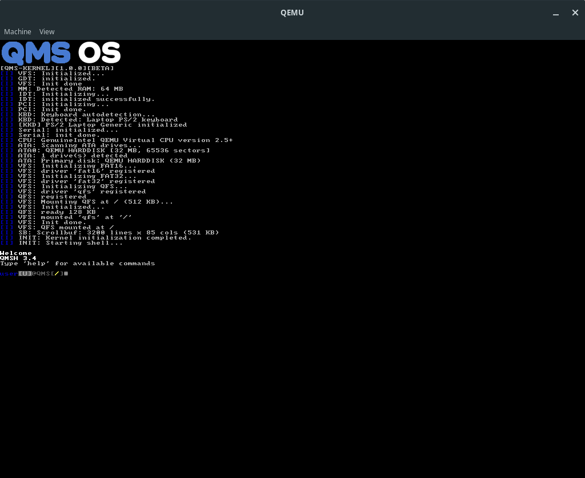

# QMS OS V1.0.0

*A simple 32-bit hobby operating system built from scratch.*

---

QMS OS is a lightweight educational operating system written in C and C++ for the i386 architecture. It features its own terminal, basic userspace, and multiple filesystem support.



> **Important**  
> QMS OS works reliably **only in QEMU**. Real hardware support is not guaranteed and may lead to instability or data corruption.

---

## Features

### Core
- 32-bit protected mode
- Framebuffer terminal with scrollback buffer
- Basic memory management
- IDT and interrupt handling
- ATA PIO driver
- QEX Aplications

### Filesystems
- QFS (native simple filesystem)
- FAT16 (read/write)
- FAT32 (read/write)

### Drivers
- PS/2 keyboard (standard and laptop layouts)
- Serial port (COM)
- LFB mode

---

## Building

```
make
```

To build only the kernel:

```
make kernel
```

### Running in QEMU:

```
make run     # build and run (no disk)
make rundisk # build and run
```

---

## Project Structure

```
qms-src/
├── kernel/          - Kernel source code
├── assets/          - Documentation and images
├── disk.img         - Bootable disk image
└── Makefile         - Build make script
 ...
```

---

## Documentation

Detailed documentation is available in the [`assets/doc/`](assets/doc/) directory:

---

## Disclaimer

This is an **early experimental release** (Version 1.0.0).  
The system is developed for learning and hobby purposes.

---

## License

Copyright (c) Roit

Distributed under the **BSD 2-Clause License**.  
See the `LICENSE` file for details.

---

**Last updated:** May 2026
